<picture>
  <source media="(prefers-color-scheme: dark)" srcset="assets/header-dark.svg">
  
</picture>

<picture>
  <source media="(prefers-color-scheme: dark)" srcset="assets/typing-dark.svg">
  
</picture>

I like taking a project the whole way: from the database and the API, to the app people tap on, to the device in the field and the server it reports to.

<picture>
  <source media="(prefers-color-scheme: dark)" srcset="assets/focus-dark.svg">
  
</picture>

  

<picture>
  <source media="(prefers-color-scheme: dark)" srcset="assets/section-projects-dark.svg">
  
</picture>

<picture>
  <source media="(prefers-color-scheme: dark)" srcset="assets/card-cucikuy-dark.svg">
  
</picture>
<a href="https://github.com/FauzanAzhimaa/waste-detection">
<picture>
  <source media="(prefers-color-scheme: dark)" srcset="assets/card-waste-vision-dark.svg">
  
</picture>
</a>
<picture>
  <source media="(prefers-color-scheme: dark)" srcset="assets/card-water-gate-dark.svg">
  
</picture>
<picture>
  <source media="(prefers-color-scheme: dark)" srcset="assets/card-minimarket-dark.svg">
  
</picture>

<b>Earlier projects</b>

 

- [Web Kuliner Masakan Nusantara](https://github.com/FauzanAzhimaa/Web-Kuliner-Masakan-Nusantara): a multi-page website about Indonesian regional dishes. HTML, CSS, JavaScript.
- [Restaurant Code With GUI](https://github.com/FauzanAzhimaa/Restaurant-Code-With-GUI): a restaurant ordering app with a Tkinter interface and a JSON menu.

 

<picture>
  <source media="(prefers-color-scheme: dark)" srcset="assets/section-stack-dark.svg">
  
</picture>

<picture>
  <source media="(prefers-color-scheme: dark)" srcset="assets/stack-dark.svg">
  
</picture>

  

<picture>
  <source media="(prefers-color-scheme: dark)" srcset="assets/section-contact-dark.svg">
  
</picture>

<a href="mailto:fauzanazhm22@gmail.com">
<picture>
  <source media="(prefers-color-scheme: dark)" srcset="assets/contact-dark.svg">
  
</picture>
</a>
