<picture>
  <source media="(prefers-color-scheme: dark)" srcset="assets/header-dark.svg">
  
</picture>

<picture>
  <source media="(prefers-color-scheme: dark)" srcset="assets/typing-dark.svg">
  
</picture>

I'm an Information Technology student who likes taking a project the whole way: from the database and the API, to the app people tap on, to the server it runs on. Lately that has meant a point-of-sale SaaS for laundry businesses, a computer vision model for spotting waste piles, and an IoT water gate for a farmers' group.

## What I work on

<table>
<tr>
<td width="50%" valign="top">

**Full-stack web & mobile** 
React and Tailwind on the front, NestJS or Express with PostgreSQL behind it. I package the same web app for Android with Capacitor and for desktop with Tauri, and wire in payments through Midtrans.

</td>
<td width="50%" valign="top">

**Computer vision** 
Training image classifiers with TensorFlow/Keras (MobileNet), explaining predictions with Grad-CAM heatmaps, and experimenting with YOLO for detection. Served through Flask and Docker.

</td>
</tr>
<tr>
<td width="50%" valign="top">

**IoT & embedded** 
ESP32 nodes that talk over LoRa, sync with Firebase Realtime Database, and drive motors with the safety logic (limit switches, timeouts, fault lock) kept on the device itself.

</td>
<td width="50%" valign="top">

**Security & infrastructure** 
Linux servers on VPS, Nginx, Cloudflare Tunnel, and a Wazuh SIEM lab that monitors a web server and an MDM platform. I designed the lab's network topology.

</td>
</tr>
</table>

## Featured projects

<table>
<tr>
<td width="50%" valign="top">

### CuciKuy · Laundry POS
Multi-tenant SaaS for laundry shops with owner and cashier roles, branch management, and subscription tiers enforced at the API level. Runs on web, Android, and desktop from one codebase.

`React` `NestJS` `TypeORM` `PostgreSQL` `Capacitor` `Tauri` `Midtrans`

Source is private. Happy to demo on request.

</td>
<td width="50%" valign="top">

### [Waste Vision](https://github.com/FauzanAzhimaa/waste-detection)
Classifies an area as clean, light pile, or heavy pile, highlights the reason with a Grad-CAM heatmap, and suggests a handling priority per location. Includes training scripts, evaluation, and deployment notes.

`TensorFlow` `Keras` `Grad-CAM` `YOLO` `Flask` `Docker`

</td>
</tr>
<tr>
<td width="50%" valign="top">

### Smart Water Gate
IoT control and monitoring for an irrigation gate. One ESP32 acts as the Wi-Fi/Firebase gateway, the other drives the motor over LoRa. Supports auto and manual modes with a live web dashboard.

`ESP32` `LoRa` `Firebase` `Web dashboard`

</td>
<td width="50%" valign="top">

### Minimarket Management System
Point of sale with admin and cashier roles, batch stock tracking with expiry dates, sales reports, and Telegram alerts for products about to expire.

`Python` `Flask` `MongoDB` `Telegram Bot`

Source is private. Happy to demo on request.

</td>
</tr>
</table>

<b>Earlier projects</b>

 

- [Web Kuliner Masakan Nusantara](https://github.com/FauzanAzhimaa/Web-Kuliner-Masakan-Nusantara): a multi-page website about Indonesian regional dishes. HTML, CSS, JavaScript.
- [Restaurant Code With GUI](https://github.com/FauzanAzhimaa/Restaurant-Code-With-GUI): a restaurant ordering app with a Tkinter interface and a JSON menu.

## Tech stack

**Languages** 

**Web, mobile & desktop** 

**Data & AI** 

**IoT, infra & security** 

## Get in touch

Happy to talk about any of the projects above, or something new you'd like to build.

