<picture>
  <source media="(prefers-color-scheme: dark)" srcset="assets/header-dark.svg">
  
</picture>

<picture>
  <source media="(prefers-color-scheme: dark)" srcset="assets/typing-dark.svg">
  
</picture>

I'm an Information Technology student who likes taking a project the whole way: from the database and the API, to the app people tap on, to the server it runs on.

<table>
<tr>
<td width="25%" valign="top">

**Full-stack** 
React and NestJS on PostgreSQL, shipped to web, Android, and desktop from one codebase.

</td>
<td width="25%" valign="top">

**Computer vision** 
Image classifiers in TensorFlow, explained with Grad-CAM, served through Flask and Docker.

</td>
<td width="25%" valign="top">

**IoT** 
ESP32 nodes over LoRa and Firebase, with safety logic kept on the device.

</td>
<td width="25%" valign="top">

**Security ops** 
Linux on VPS, Nginx, Cloudflare Tunnel, and a Wazuh SIEM lab I designed the topology for.

</td>
</tr>
</table>

## Featured projects

<picture>
  <source media="(prefers-color-scheme: dark)" srcset="assets/card-cucikuy-dark.svg">
  
</picture>
<a href="https://github.com/FauzanAzhimaa/waste-detection">
<picture>
  <source media="(prefers-color-scheme: dark)" srcset="assets/card-waste-vision-dark.svg">
  
</picture>
</a>
<picture>
  <source media="(prefers-color-scheme: dark)" srcset="assets/card-water-gate-dark.svg">
  
</picture>
<picture>
  <source media="(prefers-color-scheme: dark)" srcset="assets/card-minimarket-dark.svg">
  
</picture>

<b>Earlier projects</b>

 

- [Web Kuliner Masakan Nusantara](https://github.com/FauzanAzhimaa/Web-Kuliner-Masakan-Nusantara): a multi-page website about Indonesian regional dishes. HTML, CSS, JavaScript.
- [Restaurant Code With GUI](https://github.com/FauzanAzhimaa/Restaurant-Code-With-GUI): a restaurant ordering app with a Tkinter interface and a JSON menu.

## Tech stack

<picture>
  <source media="(prefers-color-scheme: dark)" srcset="assets/stack-dark.svg">
  
</picture>

## Get in touch

<a href="mailto:fauzanazhm22@gmail.com">
<picture>
  <source media="(prefers-color-scheme: dark)" srcset="assets/contact-dark.svg">
  
</picture>
</a>
